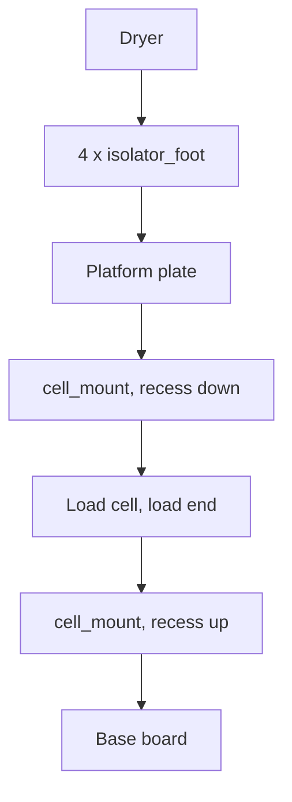

# Assembly

Build it on the bench, prove it works, and only then put it under the dryer.
Every step here is reversible except drilling the lid, and the order is chosen so
that when something does not work you have only changed one thing.

Detail lives in two other places and is not repeated here: the board, its
layout rules and the ribbon pinout are in [hardware/README.md](../hardware/README.md),
and the printed parts and screws are in [mechanical/README.md](../mechanical/README.md).

## What you need

**Electronics**

| Part | Qty | Notes |
| --- | --- | --- |
| Seeed XIAO ESP32-C6 | 1 | |
| Carrier PCB, assembled | 1 | Or the breadboard equivalent for stage 1 |
| PN5180 module | 1 | Any of the bare modules on sale |
| 5 kg single point load cell | 1 | TAL220 class |
| LM75B, TMP102 or DS18B20 | 1 | I2C at 0x48-0x4B, or one-wire with a 4.7k pull-up |
| 2x5 IDC ribbon, under 30 cm | 1 | To the reader |
| 5 V USB-C supply, 1 A | 1 | |
| Blank OpenPrintTags | 1 per spool | Prusa's 10-pack |

**Mechanical**

| Part | Qty | Notes |
| --- | --- | --- |
| Base board, 300 x 220 mm | 1 | 12 mm plywood or 6 mm aluminium |
| Platform, 300 x 220 mm | 1 | Same |
| Printed parts | 1 set | `mechanical/stl/` |
| M5 x 20 screws | 4 | Into the load cell; confirm M5 against your cell |
| M4 x 25 wood screws | 2 | Overload stop, from below |
| M3 x 10 self-tapping | 2 | Antenna clamps |
| Thermal adhesive | | For bonding the temperature sensor to the cell |

## Stage 1: electronics on the bench

Nothing mounted, nothing glued, dryer not involved.

1. Assemble the carrier in the order in
   [hardware/README.md](../hardware/README.md#assembly-order) — passives, then
   connectors, then the XIAO last — and do the `AVDD` check before the XIAO goes
   on. 4.25-4.35 V at TP1 means the analog side is alive.
2. Wire the load cell to J2. Confirm the colours against your cell's datasheet
   rather than trusting the usual red/black/green/white.
3. Crimp the ribbon and connect the reader. Check the module's silkscreen: the
   header order differs between the boards on sale, and pin 1 is not always
   where you would expect.
4. Flash the firmware ([build.md](build.md)) and open the serial monitor.
5. Join the device to Wi-Fi. With no credentials compiled in it raises an access
   point, `openprinttag-dryer` / `printtag`; connect and use the portal's
   Settings page.
6. Run the self-test at `http://openprinttag-dryer.local/selftest`. This is
   [test 1 in the validation procedure](validation.md#1-bench-self-test), and
   the rest of the build is a waste of time until it passes.
7. Press on the load cell with a finger and watch the raw counts move. If they
   move the wrong way, swap `SIG+` and `SIG-` now — the span calibration would
   otherwise accept an inverted cell as a negative scale factor and everything
   downstream would be subtly wrong.
8. Hold a blank tag against the reader coil. The self-test should report a UID
   and the tag's geometry: 79 blocks of 4 bytes.

Only when all eight pass does anything get mounted.

## Stage 2: the scale sandwich

1. Find the middle of the base board and mark the cell's footprint there. A
   single point cell wants to be under the centre of the load, and being 20 mm
   off is worth a gram or two of error depending where the spool sits.
2. Bolt the cell's **fixed** end to the base board through a `cell_mount` with
   its recess upwards. The cell's own label usually marks which end takes the
   load; if it does not, the fixed end is the one whose bolt holes are further
   from the strain gauge.
3. Bolt the **load** end to the platform through the second `cell_mount`, recess
   down. Do not overtighten: the threads are in aluminium and the printed spacer
   gives no warning before they strip.
4. Screw the `overload_stop` to the base board from below, positioned under a
   corner of the platform. Check by hand that the platform has about 1.5 mm of
   travel before it lands on the stop.
5. Bond the temperature sensor to the **body of the cell** with thermal
   adhesive. Not to the platform, not to the base: the compensation coefficient
   is measured against the cell's own temperature, and a sensor measuring the air
   is measuring the wrong thing. Route its lead to J4 with slack — a taut wire
   across the gap is a spring in parallel with the load cell.
6. Put the four `isolator_foot` parts on the platform where the dryer's feet
   land, and set the dryer on them so its rubber feet drop into the pockets.

Cable discipline matters more here than it looks. Every wire that crosses from
the base board to the platform is mechanically in parallel with the load cell.
Leave a generous loop in each, route them all at the same place, and let them
hang rather than pulling them tight.

## Stage 3: the reader at the lid

1. Find the spool's axis. With a spool in the dryer, mark the centre of the hub
   on the **outside** of the side lid.
2. Hold the bracket with the module in it against the inside of the lid, centred
   on that mark, and run the read test from the portal's self-test page. Move it
   about while the test runs; this is [test 3](validation.md#3-lid-read-reliability)
   and it is much easier to do with the bracket loose in your hand than screwed
   down in the wrong place.
3. Once 20 of 20 attempts find the tag, fix the bracket: double-sided tape on
   its flat face is enough, and two M3 screws are better if you are willing to
   drill.
4. Dress the ribbon along the lid hinge with enough slack that opening the lid
   does not stretch it. A ribbon that pulls out of the connector at full lid
   travel is the failure that will find you a month later.

## Stage 4: the rest

1. Calibrate: [calibration.md](calibration.md).
2. Provision a spool: [provisioning.md](provisioning.md).
3. Connect it to Home Assistant: [../homeassistant/README.md](../homeassistant/README.md).
4. Work through the remaining validation tests, particularly the thermal drift
   run, which needs a full drying cycle: [validation.md](validation.md).

## Where it goes wrong

**The weight changes when you touch a cable.** A wire is bridging the platform
and the base with tension in it. Loosen it.

**The weight depends on where the spool sits in the dryer.** The platform is
flexing, or the cell is not under the middle. Stiffer platform, or move the cell.

**The reading creeps for an hour after the dryer starts.** That is exactly what
the drift run measures and compensates. It is only a problem if it does not
settle, which means heat is reaching the cell rather than being resisted by the
feet.

**The reader works on the bench and not at the lid.** Concentricity before
distance: the coil wants to be over the tag's Ø74-79 mm ring, not over the middle
of the spool. See [test 3](validation.md#3-lid-read-reliability).
