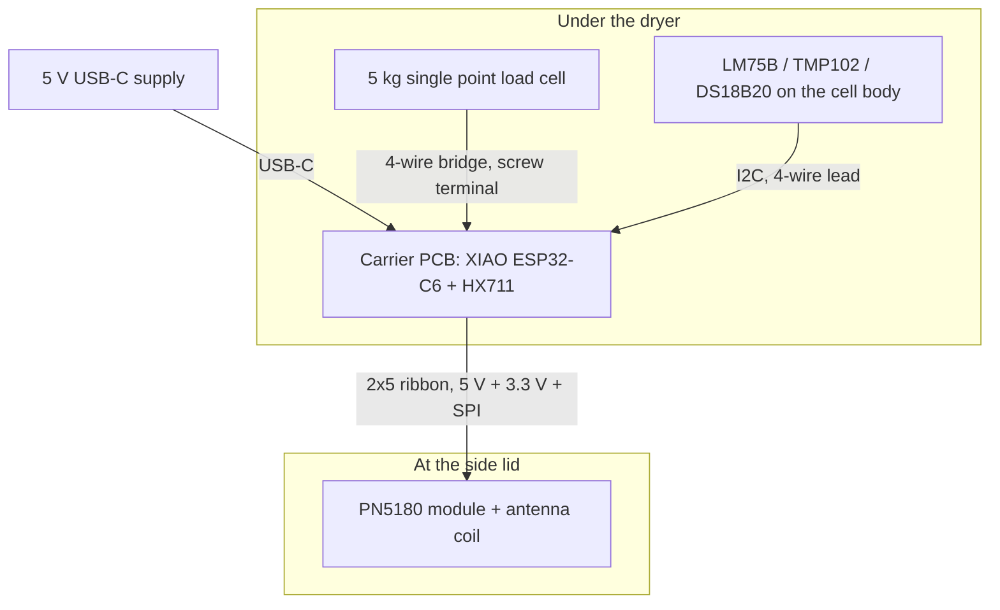

# Hardware

Two boards and three cables. The carrier sits under the dryer with the load
cell, a ribbon runs up to a PN5180 module at the side lid, and a small
temperature sensor is bonded to the load cell body.



## Why a carrier board at all

The obvious build is three breakout modules and jumper wires, and it would
mostly work. Two things make it worth a board:

**The HX711 wants two different supplies.** Every HX711 breakout ties the
analog and digital supplies together, so you pick between exciting the bridge
at 3.3 V -- throwing away a third of the signal before it reaches the ADC --
and running 5 V logic into an ESP32-C6 that is not rated for it. As a bare IC,
`VSUP` takes 5 V and produces 4.3 V of excitation through Q1, while `DVDD` runs
at 3.3 V, so `DOUT` and `PD_SCK` connect straight to the XIAO.

**Analog wiring wants to be short.** The bridge output is a couple of
millivolts at full scale. That signal deserves a guarded pair of a few
centimetres with a filter at the far end, not 20 cm of jumper wire next to a
switching heater.

The reader is the opposite case: it needs to be at the lid, 30 cm away, and its
signals are digital SPI. Hence the split -- everything analog on one small
board, one ribbon for everything digital.

## What is in this directory

| File | What it is |
| --- | --- |
| `carrier/generate_netlist.py` | The schematic, as code. Defines every part and net, runs an electrical rules check, and writes the three files below. |
| `carrier/openprinttag-carrier.net` | KiCad netlist, for importing into the PCB editor. |
| `carrier/openprinttag-carrier.csv` | Bill of materials. |
| `carrier/netlist.md` | The same connectivity as a table, readable without KiCad. |

Regenerate after any change:

```bash
pip install skidl
cd hardware/carrier && python3 generate_netlist.py
```

The electrical rules check is the point of doing it this way. It reads pin
functions and net drives, so an input nobody drives, two outputs shorted
together or a power pin fed from a passive net all fail the run rather than
waiting to be found on the bench. It currently reports zero errors and zero
warnings.

## Getting from netlist to board

The layout is a manual step in KiCad: create a project in `hardware/carrier/`,
import `openprinttag-carrier.net`, and place the board. Two things to do first.

**Check the footprints.** The names in the netlist are KiCad's standard
libraries, except `Seeed_XIAO:XIAO_ESP32C6`, which comes from Seeed's own KiCad
library. Confirm every association in the footprint assignment dialog before
ordering anything; a name that no longer exists in a newer KiCad release is a
lot cheaper to find there than on a delivered board.

**Check U1 against a real module.** The XIAO's 2x7 castellated pads are on a
2.54 mm pitch, but measure the row spacing against the module in your hand
rather than trusting a downloaded footprint. If in doubt, lay out for 2x7
through-hole pads and fit sockets -- it costs a few millimetres of height and
makes the module removable.

### Layout rules that matter

Ordered by how much damage getting them wrong does.

1. **The analog corner is a separate region.** U2, R3-R7, C6-C12, J2 and both
   test pads go together at one end of the board, with their own ground area
   that meets digital ground only at R5. Nothing digital crosses it -- not the
   ribbon, not the LED, not the USB traces.
2. **The bridge pair is differential.** Route `CELL_SIG+`/`CELL_SIG-` and
   `HX_INA+`/`HX_INA-` as a matched pair, same length, tight together, with
   ground either side on the same layer and ground underneath. Keep them under
   30 mm if you can.
3. **Excitation is a power path.** `AVDD` and `AGND` out to J2 carry the whole
   bridge current, about 4 mA for a 1 kΩ cell, and any resistance in them shows
   up directly as a span error. Use 0.5 mm traces and keep them symmetric.
4. **The 5 V bulk goes next to J3.** C1 belongs within a few millimetres of the
   ribbon connector's power pins. The reader's field driver pulls its current in
   bursts and the point of C1 is to source those bursts locally rather than
   through a trace shared with the ADC.
5. **Ground is one plane on the bottom layer**, split only for the analog
   region, with the split crossed by nothing but R5. On a two-layer board that
   means checking every top-layer trace for where its return current has to go.
6. **The C6 antenna needs clearance.** Keep copper out from under the XIAO's
   antenna end -- the module's own outline shows where -- and put the board's
   edge, not a ground pour, next to it.

A two-layer 1.6 mm board around 50 x 40 mm is plenty. There is no high-speed
signal here; SPI runs at 3.5 MHz.

### Fabrication outputs

The gerbers come out of KiCad once the layout exists, so they are not checked in
here -- there is nothing to generate them from until the board is placed. When
you get there, the order is nothing unusual: two layers, 1.6 mm FR4, 1 oz
copper, HASL, 6 mil track and clearance minimum. Use **File > Fabrication
Outputs > Gerbers** with Protel extensions, drill files in Excellon with a
separate plated/non-plated file, and export the position file if you want the
0603 parts machine-placed. Run the design rules check first with the fab's rules
loaded, not KiCad's defaults.

## The ribbon to the reader

Ten conductors, 2.54 mm IDC, alternating ground either side of the clock:

| Pin | Signal | Pin | Signal |
| --- | --- | --- | --- |
| 1 | +5 V | 2 | GND |
| 3 | SCK (through R8, 33 Ω) | 4 | GND |
| 5 | MOSI (through R9, 33 Ω) | 6 | MISO |
| 7 | NSS | 8 | BUSY |
| 9 | RST | 10 | +3.3 V |

Both supplies go up the ribbon because the PN5180 needs 5 V for its field
driver and 3.3 V for its logic side, and its own module regulator is not sized
for the coil. Keep the ribbon under 30 cm; the firmware clocks SPI at 3.5 MHz,
which is the derating a 30 cm run wants on a C6.

At the reader end, the module's header order differs between the boards on sale,
so check the silkscreen and crimp the IDC accordingly rather than assuming pin 1
lines up.

## Power

| Rail | Source | Feeds | Worst case |
| --- | --- | --- | --- |
| VBUS 5 V | USB-C, fused at 500 mA | +5 V through D1 | -- |
| +5 V | VBUS, or the XIAO's USB when flashing | XIAO, HX711 `VSUP`, reader, LED | about 350 mA with the RF field on |
| +3.3 V | XIAO's own regulator | HX711 `DVDD`, reader logic, temperature sensor, pull-ups | about 40 mA |
| AVDD 4.3 V | HX711 regulator through Q1 | load cell bridge | about 5 mA |
| VLED | +5 V less a diode | WS2812 | 20 mA at the brightness the firmware uses |

A 1 A phone charger is more than enough. D1 exists so that plugging a computer
into the XIAO for flashing, while the USB-C supply is connected, does not put
two sources on one rail.

## Assembly order

Test as you go; each step is cheap to check and expensive to skip.

1. Fit U2 and its passives, then the connectors, then U1 last. With U1 off the
   board you can probe the analog side without a running processor.
2. Before fitting U1, feed 5 V into the board and confirm TP1 (`AVDD`) reads
   4.25-4.35 V against TP2 (`AGND`). If it is at 5 V, Q1 or R3/R4 is wrong; if
   it is at 0 V, check U2's orientation.
3. Fit U1. Confirm 3.3 V at J4 pin 1 and 5 V at J3 pin 1.
4. Wire the load cell to J2: red `E+`, black `E-`, green `SIG+`, white `SIG-`
   for the usual TAL220 colour code, but confirm against your cell's datasheet.
   Swapped signal wires simply invert the reading, which the firmware's span
   calibration will happily accept as a negative scale factor -- so check that
   pressing down makes the number go up.
5. Bond the temperature sensor to the load cell body with thermal adhesive, not
   tape, and wire it to J4. Without it, drift compensation has nothing to work
   with and the firmware falls back to reporting uncompensated grams.
6. Crimp the ribbon, connect the reader, and run the self-test page in the web
   portal. It reports the reader's firmware version, so a wrong ribbon pinout
   shows up as a reader that never answers.

## Off-board parts

- **PN5180 module.** The bare modules on sale differ mostly in antenna size.
  Any of them will do for bring-up; read range through the lid is the open
  question, and the mitigation, if the stock coil is not enough, is a matched
  Ø75 mm antenna as described in `docs/`.
- **5 kg single point load cell,** TAL220 class. 5 kg is the right range: the
  dryer is 1.14 kg, a full spool is 1.25 kg, and the rest is headroom for
  someone leaning on the lid.
- **Temperature sensor: an LM75B, a TMP102 or a DS18B20.** The firmware probes
  I2C addresses 0x48 to 0x4B first and uses whichever answers; failing that it
  looks for a DS18B20 on the same pin, so no build-time choice is needed and the
  self-test page reports which one it found.

  The DS18B20 is a one-wire part rather than I2C, which means three differences
  at the board. It uses `SDA` as its data line and leaves `SCL` unconnected —
  they are alternatives, never both fitted, and `SDA` is the only pin spare. It
  **needs a 4.7 kΩ pull-up from that line to 3.3 V**, which is not optional: the
  processor's internal pull-up is around 45 kΩ and cannot pull the bus up inside
  a bit slot, so a sensor without one is either not detected or, worse,
  intermittent. And its conversion takes up to 750 ms, so the firmware asks for
  a reading on one visit and collects it on the next rather than blocking.

  Prefer I2C if you are buying for this. The DS18B20 is supported because it is
  what most people already own, but its bus is timed in microseconds by a
  processor that is also running Wi-Fi, so a badly timed bit is always possible;
  the driver checks every reading's CRC and discards failures, which costs a
  sample rather than corrupting a weight.
