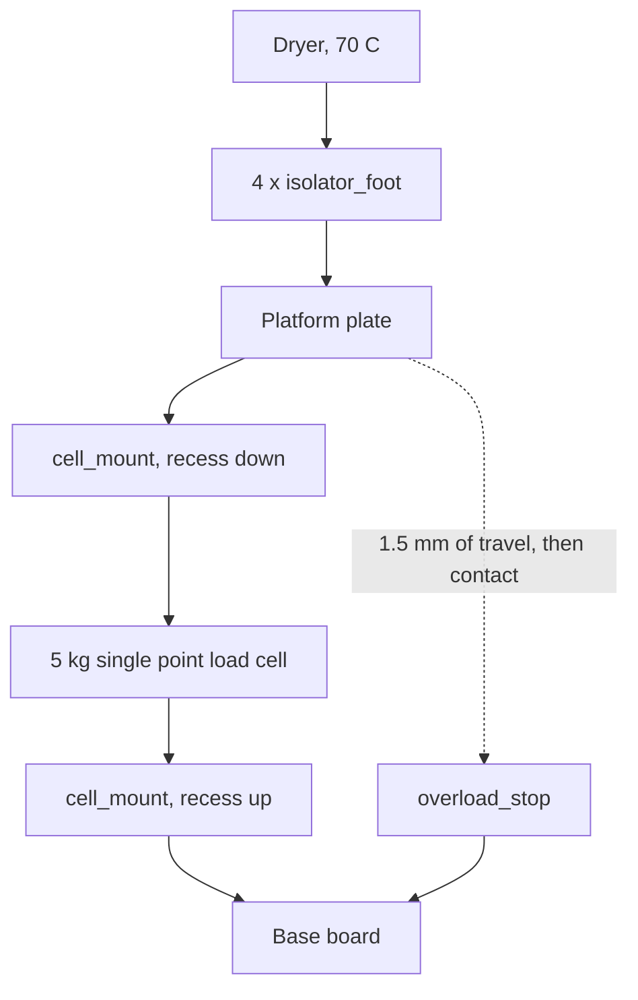
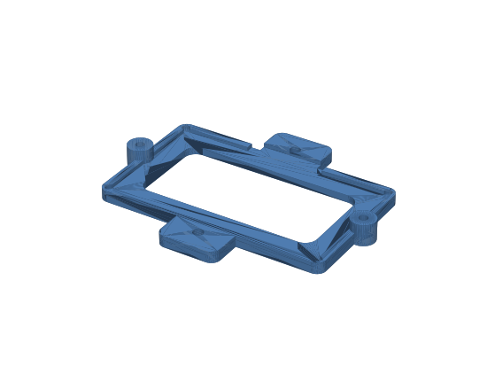
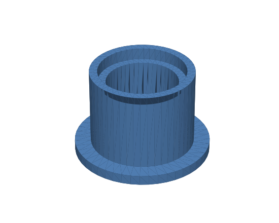

# Printed parts

Five parts, generated from `generate_parts.py`. STLs are checked in under
`stl/`; previews under `preview/`.

```bash
python3 -m venv .venv
.venv/bin/pip install trimesh manifold3d shapely rtree matplotlib
.venv/bin/python generate_parts.py --preview
```

| Part | Qty | Size | What it does |
| --- | --- | --- | --- |
| `antenna_bracket` | 1 | 85 x 68 x 7 mm | Holds the PN5180 against the inside of the side lid |
| `antenna_clamp` | 2 | 14 x 12 x 6 mm | Screws to the bracket, holds the module in |
| `cell_mount` | 2 | 34 x 20 x 10 mm | Spaces the load cell off the base and off the platform |
| `overload_stop` | 1 | 24 x 20 x 25 mm | Catches the platform if somebody leans on the dryer |
| `isolator_foot` | 4 | 34 x 34 x 22 mm | Carries the hot dryer without heating the cell |

About 72 g of filament for the set.

## What is not printed

Two flat plates, which are the one thing a printer is bad at: a 3D printed
300 x 200 mm plate warps, needs splitting, and is far less stiff than a piece of
plywood. Cut them instead.

- **Base board**, 300 x 220 mm, 12 mm plywood or 6 mm aluminium. Sits on the
  shelf and carries everything.
- **Platform**, 300 x 220 mm, 12 mm plywood or 6 mm aluminium. Carries the
  dryer. Stiffness matters here: any flex between the dryer's four feet and the
  single load cell shows up as a weight that depends on where the load sits.

If you only have one thickness, use it for both; the mounts do not care.

## The stack



Both ends of a single point load cell bolt to a flat surface with the same hole
pattern, so one printed spacer serves both ends, just turned over: recess up
under the fixed end, recess down over the load end. The spacers are what let the
beam bend, which is the only reason the cell reads anything at all -- bolt both
ends flat to two plates and you have a rigid sandwich that weighs nothing.

The stack puts the platform 26.7 mm above the base board. The stop pillar is
25.2 mm, so the platform can sink 1.5 mm before it lands, which is several times
the cell's deflection at its full 5 kg and nowhere near enough to bend it.

### Screws

| Where | Screw | Notes |
| --- | --- | --- |
| Base board into the cell's fixed end | 2 x M5 x 20, through the base and the spacer | Confirm the thread: TAL220 cells are usually M5, some clones are M4 |
| Platform into the cell's load end | 2 x M5 x 20, through the platform and the spacer | Same |
| `overload_stop` to the base board | 2 x M4 x 25 wood screws, from below | Drive into the printed pilot holes |
| `antenna_clamp` to `antenna_bracket` | 2 x M3 x 10 self-tapping | Into the printed posts |
| `antenna_bracket` to the lid | 2 x M3, or double-sided tape | The bracket's flat face is the tape surface |

Do not overtighten the M5s into the cell: the thread is in the aluminium and the
plastic spacer will not tell you when you are stripping it.

## Print settings

PETG, not PLA. The bracket lives inside a dryer that runs at 70 C, which is
above PLA's glass transition, and PLA parts in there will sag over a summer. ASA
or PC is better still if you print it, and Prusament ASA is a sensible choice
given what this device is for.

| Setting | Value | Why |
| --- | --- | --- |
| Material | PETG, or ASA/PC | 70 C inside the dryer |
| Layer height | 0.2 mm | Nothing here needs finer |
| Perimeters | 3 | The feet are load bearing and thin walled |
| Infill | 100% for `cell_mount` and `overload_stop`, 25% elsewhere | Those two are in the load path, and any give in them shows up as hysteresis in the weight |
| Supports | None needed | Every part is modelled to print without any |
| Orientation | As exported | The clamps are exported upside down for exactly this reason |

The `cell_mount` parts are the ones to print carefully. They sit in the load
path, so a sloppy print with gaps between perimeters and infill will creep and
show up as tare drift. Solid infill and the plate on the bed.

## The reader bracket



The module drops into the pocket from behind and two clamps hold it. There is no
snap fit on purpose: a snap would have to be tuned to one board thickness and
one printer's tolerances, while a clamp screwed down over the edge holds any of
the boards on sale.

Mount it on the **inside** of the side lid, centred on the spool's axis, so the
coil sits parallel to the tag and concentric with it. That last part matters
more than the distance: the tag's antenna is a ring trace at Ø74-79 mm, and a
small coil centred on that ring couples far better than the same coil sitting
off to one side. Mark the spool centre on the outside of the lid, then work from
that mark.

The flat face goes against the lid. It is a lip 2.4 mm thick, which is invisible
at 13.56 MHz -- the window in it is there to save plastic and let the module's
LEDs be seen, not for the radio.

Two things to measure before printing: the module (`MODULE` in the script; the
boards on sale are 69-70 x 37-40 mm), and whether the lid has 85 x 68 mm of flat
inside surface to put it on.

## The feet



An open column with a flange, bored right through, carrying the dryer on a
narrow rim at the top. The dryer's own rubber feet drop into the 22 mm pocket.

The bore is the point. Heat has to travel down a 4 mm annular wall for 20 mm
rather than straight through a solid block, which comes to about 2.8 mW/K per
foot -- roughly half a watt into the platform for all four at a 48 K difference.
That is small enough that the firmware's drift compensation is trimming a
residual rather than chasing the heater, and it is why the walls are thin and
the column is not a solid puck.

Radiation from the dryer's hot underside matters about as much as conduction
through the feet, so if the drift characterisation run comes out worse than you
would like, a sheet of foil-faced foam on the platform under the dryer is the
cheapest next step.
